# Solution of agricultural water resource dispatching problem based on improved genetic algorithm (Matlab code implementation)

Improved Genetic Algorithm for Solving Agricultural Water Resources Scheduling Problem:
\n     \n      \n      \n      \n      \n      \n      \n      \n      \n      \n      \n      \n      Refer to other issues:
\n     \n      \n      \n      \n      \n      \n      \n   \n      \n      \n      \n      \n      \n      Running results:

## Images

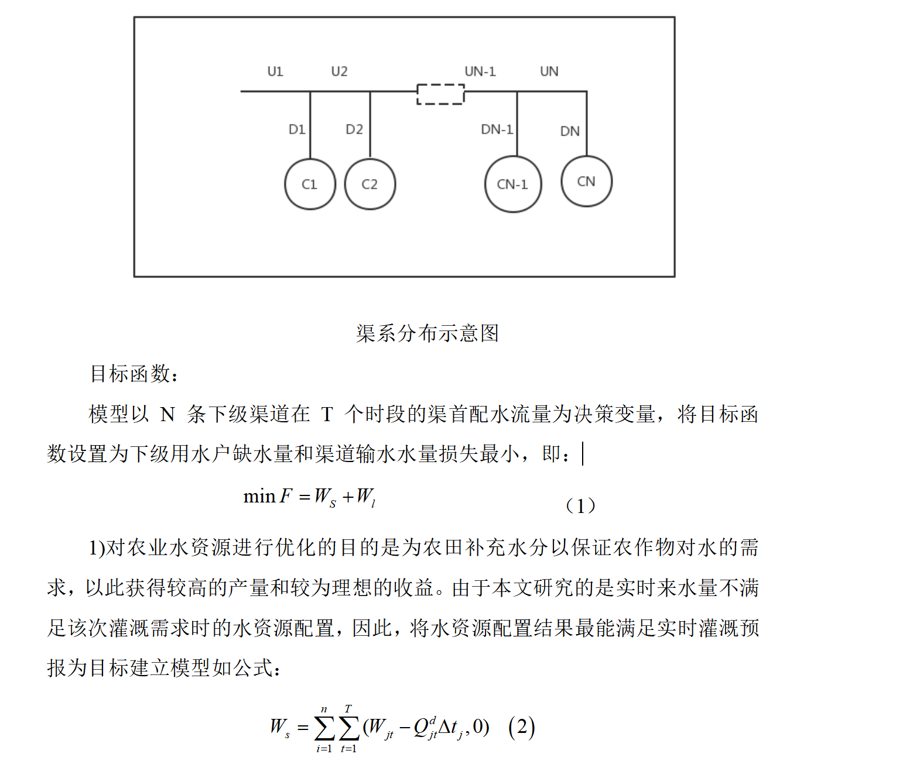
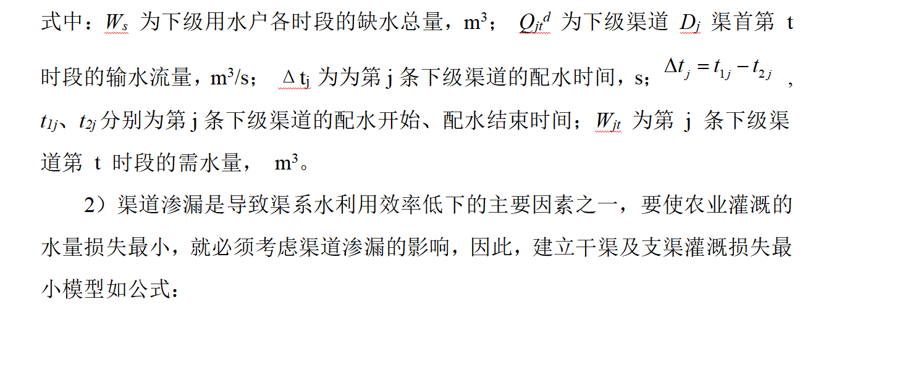
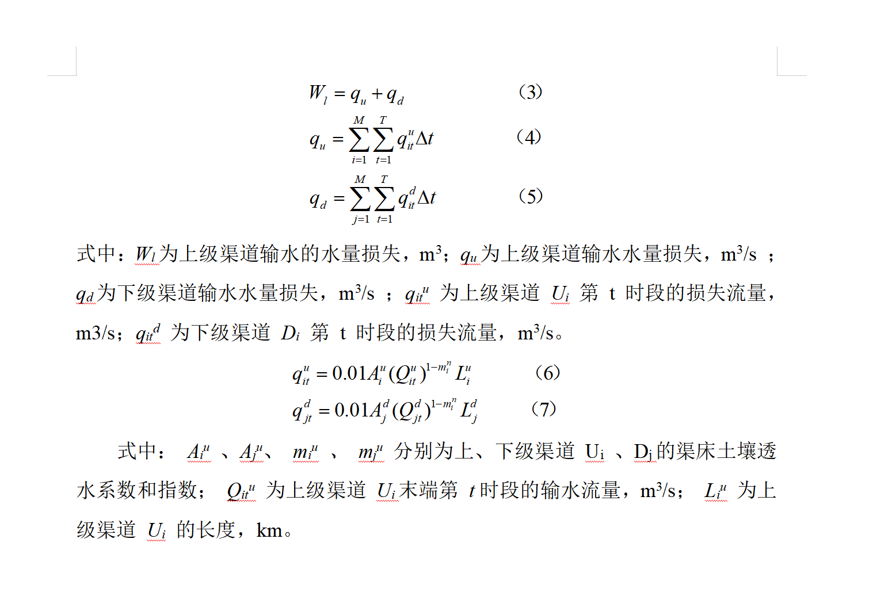
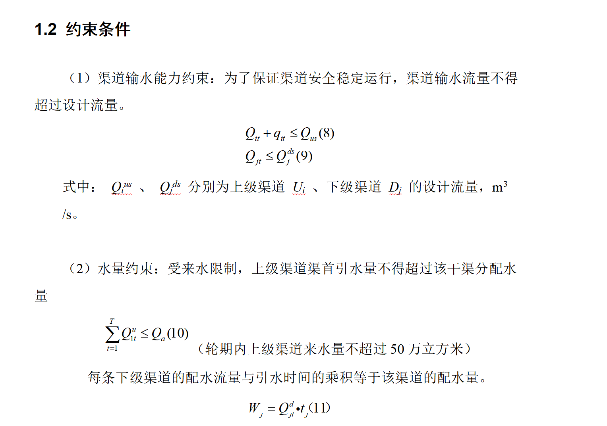
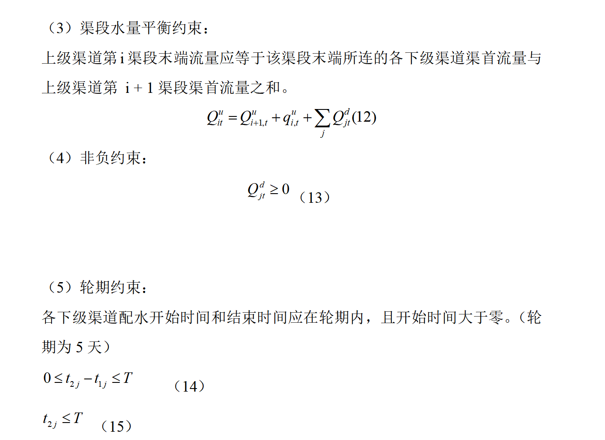
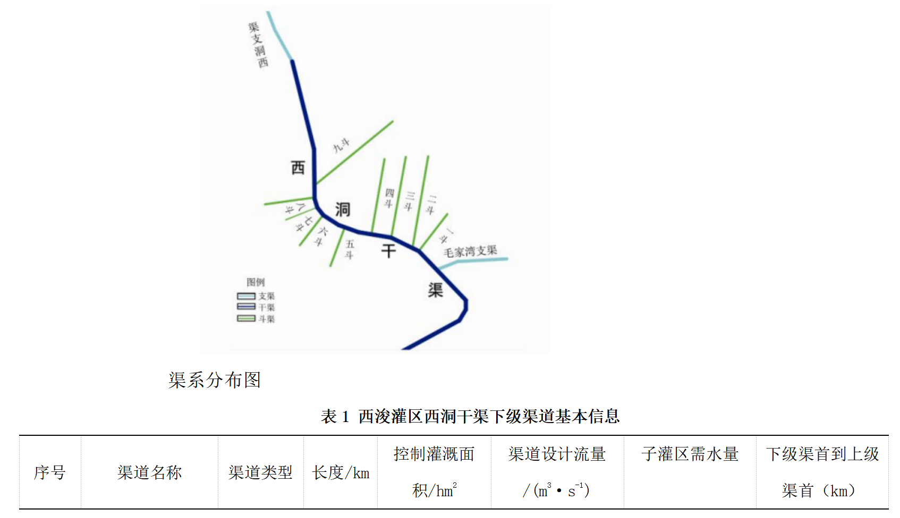
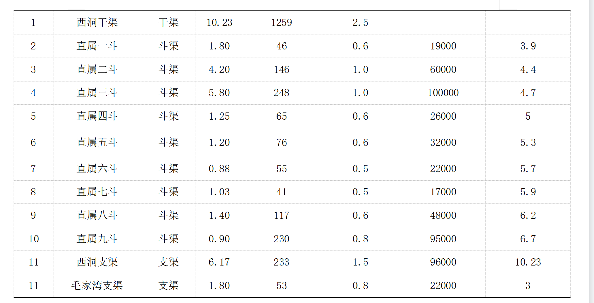
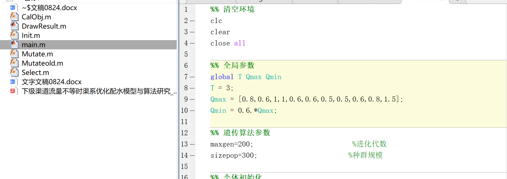
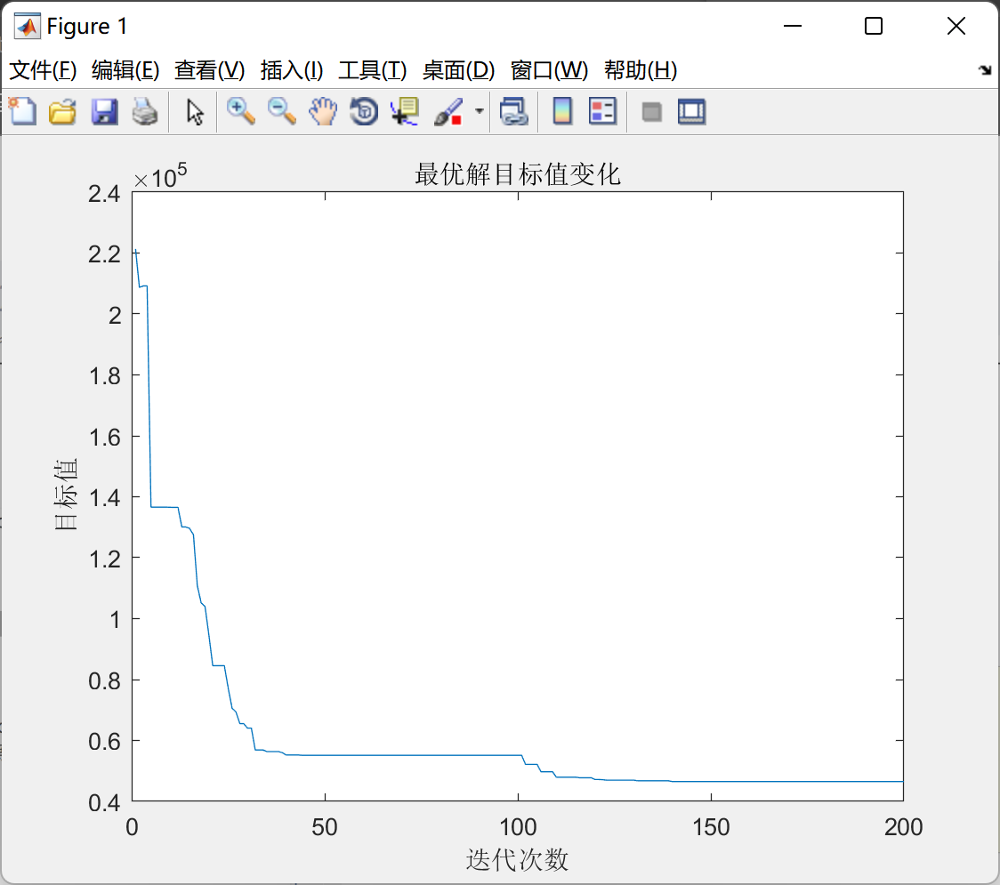
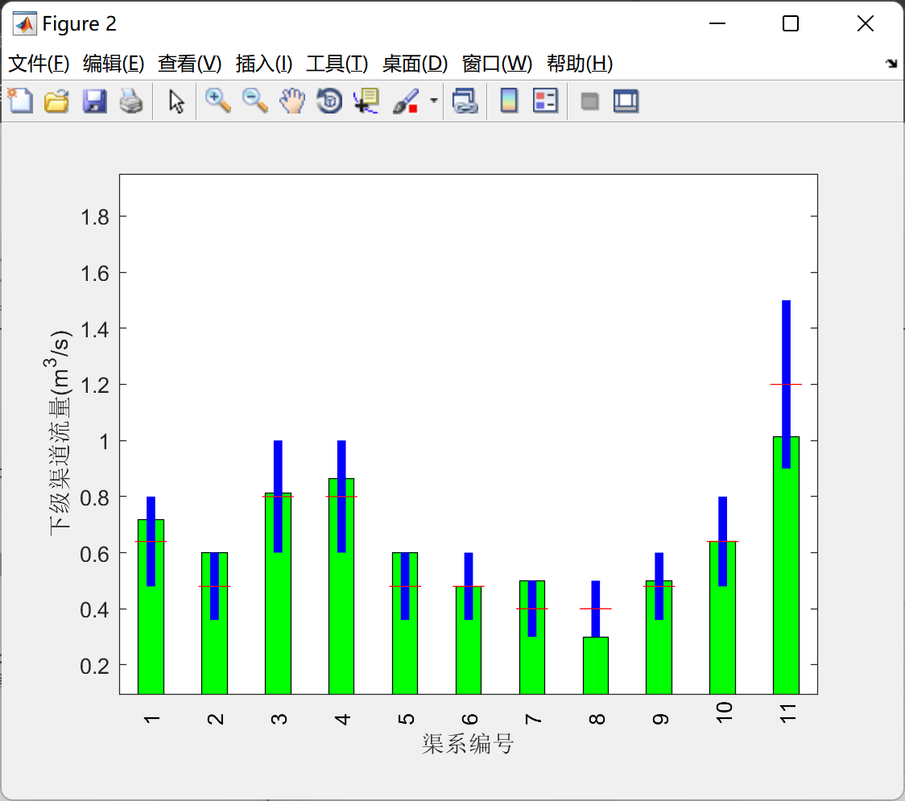
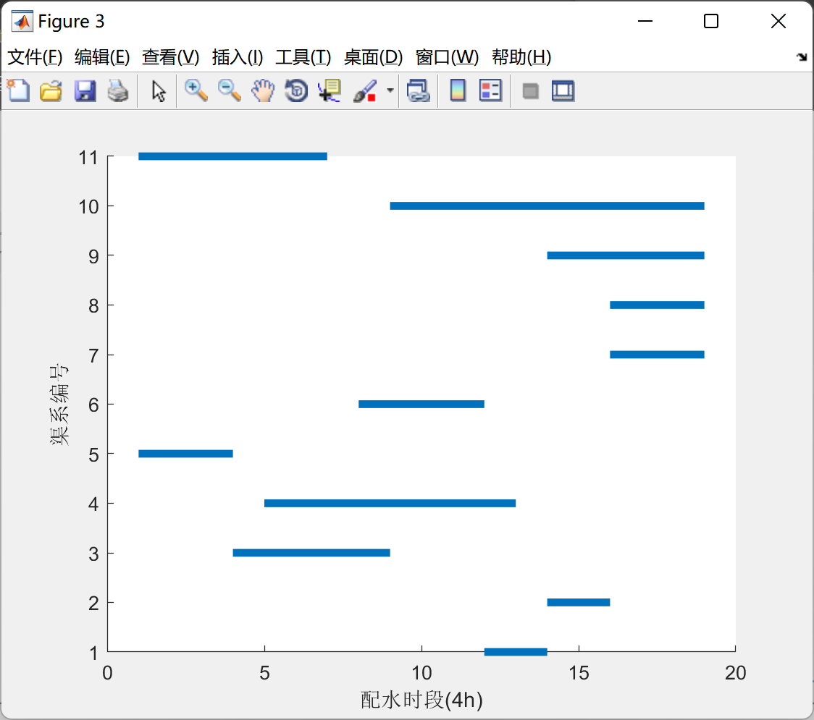
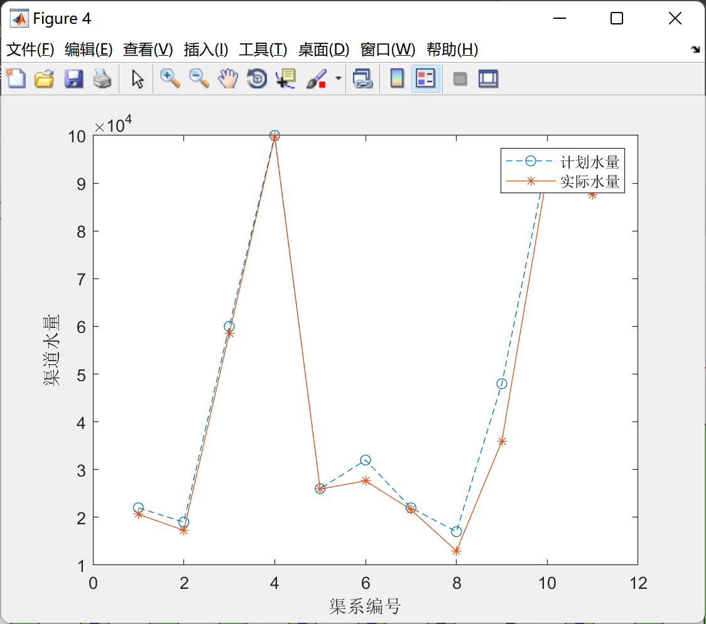

<!-- PAYMENT_BLOCK -->

## Get this dataset

- Payment link (Stripe): [Buy now](https://buy.stripe.com/3cs8yP7sY87d0vu9AB)
- Payment QR code: 

<!-- /PAYMENT_BLOCK -->
